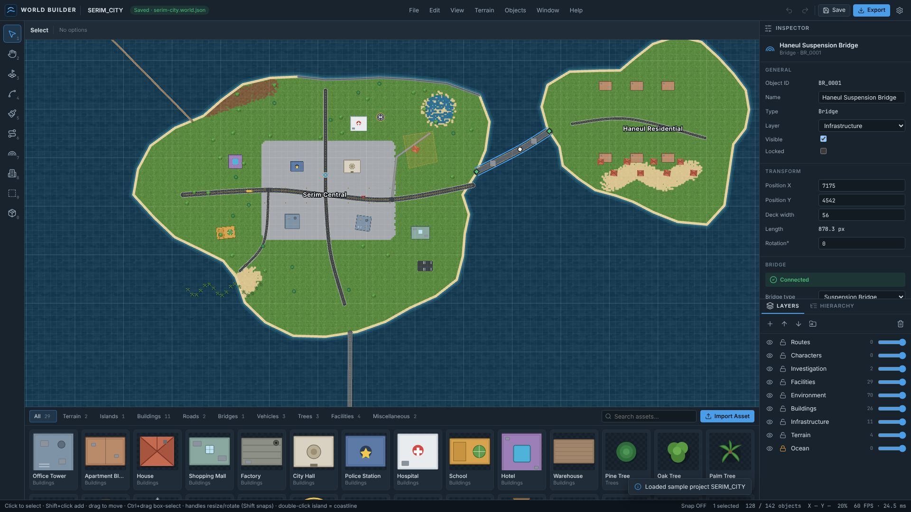

# WORLD BUILDER 1.0.0



추리게임·오픈월드 게임용 **2D 월드 맵 편집기**입니다. 섬을 만들고, 해안선과 지형을 다듬고, 도로·다리·건물·시설물을 배치한 뒤 게임에서 읽을 수 있는 JSON / ZIP 프로젝트로 저장합니다.

- 브라우저에서 실행되는 독립형 웹 앱 (서버·빌드 과정 없음)
- HTML5 · CSS3 · Vanilla JavaScript · PixiJS 8 · Lucide · Zod · JSZip · IndexedDB
- 모든 라이브러리는 `lib/` 폴더에 포함되어 있어 **인터넷 없이도** 동작합니다.

## 실행 방법

### 1) GitHub Pages (권장)
`main` 브랜치에 합쳐진 뒤 아래 주소에서 바로 실행됩니다.

```
https://conascode.github.io/conas-open/work/WORLD_BUILDER/
```

### 2) 내 컴퓨터에서 실행
ES 모듈은 `file://`로 열면 브라우저가 막기 때문에, 아무 정적 웹 서버로 폴더를 열어야 합니다.

```bash
cd work/WORLD_BUILDER
```

```bash
python3 -m http.server 8080
```

그 다음 브라우저에서 `http://localhost:8080/` 을 엽니다. (Node가 있다면 `npx serve .` 도 됩니다.)

권장 환경: 최신 Chrome / Edge (File System Access API로 "저장" 시 같은 파일에 덮어쓰기 가능). Firefox / Safari 에서는 저장 시 파일이 다운로드됩니다.

### 3) 테스트 실행
단위 테스트(Node 20+):

```bash
cd work/WORLD_BUILDER
```

```bash
node --test tests/*.test.js
```

브라우저 E2E 테스트(Playwright + Chromium 필요, 위의 웹 서버를 8765 포트로 띄운 상태에서):

```bash
node tests/e2e/phase1.cjs
```

`phase2.cjs`, `phase3.cjs`, `perf.cjs` 도 같은 방식입니다. 결과는 [docs/test-results.md](docs/test-results.md).

## 폴더 구조

```
WORLD_BUILDER/
├─ index.html              앱 진입점
├─ src/
│  ├─ app/        editor.js(중앙 컨트롤러) · main.js(부트스트랩) · perf.js(성능 테스트)
│  ├─ core/       document · commands · history · selection · camera · spatial-index
│  ├─ renderer/   renderer(PixiJS) · views(객체별 그리기) · overlay · textures
│  ├─ tools/      select · island · coastline · terrain · road · bridge · place · area · pan
│  ├─ objects/    shapes(경계/히트/변형) · terrain · road · bridge
│  ├─ panels/     inspector · layers/hierarchy · asset-library · dialogs · chrome(메뉴/툴바/상태바)
│  ├─ data/       constants · defaults(팩토리) · schema(Zod) · serialize · migrations · builtin-assets
│  ├─ storage/    idb · asset-store · zip · project-manager
│  └─ utils/      geometry · id · rle · dom · events · thumbnail
├─ assets/        terrain/ buildings/ roads/ bridges/ objects/  (샘플 SVG 에셋)
├─ styles/        main.css · layout.css · panels.css · components.css
├─ samples/       serim-city.world.json (샘플 프로젝트)
├─ docs/          architecture.md · data-schema.md · user-guide.md · test-results.md · screenshot.jpg
├─ tests/         geometry · project · serialization (.test.js) + e2e/ (Playwright)
├─ scripts/       generate-assets.mjs · generate-sample.mjs
└─ lib/           pixi.min.js · zod.js · jszip.min.js · lucide.min.js
```

## 문서
- [사용자 매뉴얼](docs/user-guide.md)
- [기술 아키텍처](docs/architecture.md)
- [JSON 데이터 구조](docs/data-schema.md)
- [테스트 결과](docs/test-results.md)

## 구현 범위
| 단계 | 상태 |
|---|---|
| PHASE 1 — Core Editor (UI, PixiJS 캔버스, 카메라, 선택/이동, Undo/Redo, JSON 저장) | 완료 |
| PHASE 2 — World Construction (섬, 해안선, 지형, 도로, 다리, 건물) | 완료 |
| PHASE 3 — Asset Management (에셋 등록/라이브러리, 레이어, Inspector, ZIP, 불러오기, 자동 저장/복구) | 완료 |
| PHASE 4 — Investigation Expansion (인물, 이동 경로, 사건, 증거, 시간별 재생) | **미구현** — `routes` 배열과 Characters / Routes / Investigation 레이어만 예약되어 있습니다 |

## 라이선스 참고
`lib/` 의 라이브러리는 각자의 라이선스(PixiJS MIT, Zod MIT, JSZip MIT/GPLv3 dual, Lucide ISC)를 따릅니다.
